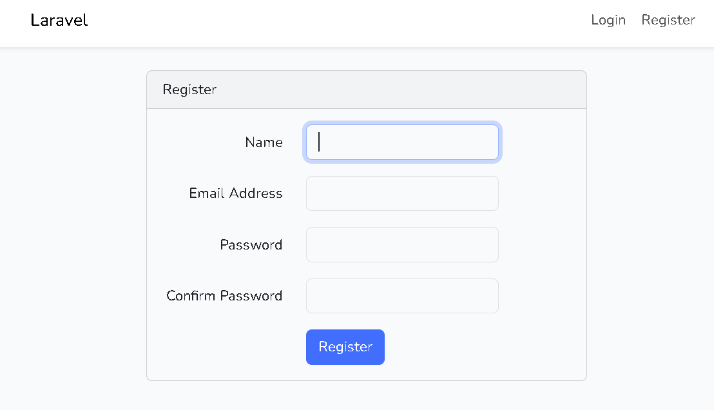
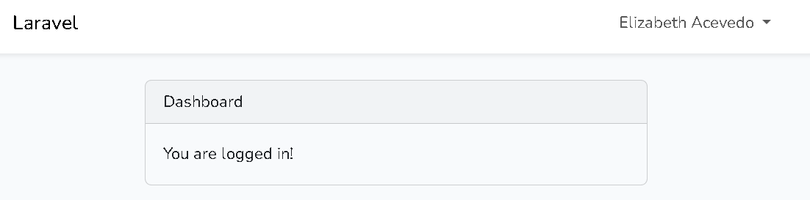

# Laboratorio #3 - Implementación del Login en Laravel (Patrón MVC)

## 👤 Datos del Estudiante

| Campo | Detalle |
|---|---|
| **Nombre** | Elizabeth Acevedo |
| **Correo** | elizabeth.acevedo@utp.ac.pa |
| **Universidad** | Universidad Tecnológica de Panamá (UTP) |
| **Materia** | Desarrollo Web |
| **Profesor** | Irina Fong |
| **Grupo** | 1S3122 |
| **Fecha** | 15 de octubre de 2026 |

---

## 📌 Introducción y Objetivos

Este repositorio documenta el desarrollo y configuración del módulo de autenticación (Login y Registro) en un proyecto de Laravel 12 bajo la arquitectura Modelo-Vista-Controlador (MVC).

**Objetivos:**
* Implementar un sistema de registro e inicio de sesión de usuarios.
* Comprender la estructura del patrón MVC en Laravel.
* Conectar la aplicación con una base de datos MySQL y verificar el almacenamiento de usuarios.

### Arquitectura MVC en el proyecto

* **Modelos (`app/Models/`):** Gestionan la lógica de datos y la comunicación con las tablas de la base de datos (por ejemplo, el modelo `User`).
* **Vistas (`resources/views/`):** Contienen las interfaces de usuario construidas con Bootstrap (`auth/login.blade.php`, `auth/register.blade.php`, `dashboard.blade.php`).
* **Controladores (`app/Http/Controllers/`):** Manejan las peticiones HTTP, procesan la lógica de autenticación y conectan los modelos con las vistas.
* **Rutas (`routes/web.php`):** Definen los puntos de entrada de la aplicación y protegen las rutas privadas mediante middleware de autenticación.

---

## ⚙️ 1. Requisitos Previos y Entorno

* **Sistema Operativo:** Windows 11
* **PHP:** Versión 8.2.29
* **Composer:** Última versión estable
* **Entorno Local (WampServer):** Apache y MySQL 8.4.7
* **Editor de Código:** Visual Studio Code
* **Gestor de Paquetes:** npm / Node.js

---

## 💻 2. Flujo de Comandos Utilizados

Para instalar el paquete de autenticación con Bootstrap y levantar la aplicación se ejecutó la siguiente secuencia de comandos en la terminal, en la raíz del proyecto (`lab-3`):

```bash
composer require laravel/ui
php artisan ui bootstrap --auth
npm install && npm run dev
php artisan migrate:fresh
php artisan serve
```

| Comando | Función |
|---|---|
| `composer require laravel/ui` | Instala el paquete de scaffolding de interfaz de usuario. |
| `php artisan ui bootstrap --auth` | Genera las vistas, controladores y rutas de autenticación con Bootstrap. |
| `npm install && npm run dev` | Instala las dependencias de frontend y compila los assets con Vite. |
| `php artisan migrate:fresh` | Elimina y recrea las tablas de la base de datos (incluida `users`). |
| `php artisan serve` | Levanta el servidor de desarrollo de Laravel. |

---

## 🗄️ 3. Configuración de la Base de Datos

La conexión a MySQL se configuró en el archivo `.env` del proyecto:

```env
DB_CONNECTION=mysql
DB_HOST=127.0.0.1
DB_PORT=3306
DB_DATABASE=laravel
DB_USERNAME=root
DB_PASSWORD=
```

> ⚠️ El archivo `.env` no se sube al repositorio por seguridad (está incluido en `.gitignore`).

---

## 🖼️ 4. Evidencias del Funcionamiento

### 4.1 Formulario de Registro
Vista de registro (`/register`) donde el usuario ingresa su nombre, correo y contraseña.



### 4.2 Dashboard tras iniciar sesión
Una vez registrado e iniciada la sesión, el usuario es redirigido al Dashboard, protegido por el middleware de autenticación.



### 4.3 Verificación en la base de datos
Consulta `SELECT * FROM users;` en MySQL, donde se comprueba que el usuario quedó guardado y que la contraseña se almacena **encriptada (hash bcrypt)**, nunca en texto plano.


---

## ✅ 5. Conclusiones

* Laravel UI permite generar rápidamente un sistema de autenticación completo siguiendo el patrón MVC.
* Las contraseñas se almacenan de forma segura mediante hashing, lo que se evidenció en la tabla `users`.
* Las rutas privadas, como el Dashboard, quedan protegidas con middleware, permitiendo el acceso solo a usuarios autenticados.

---

## 🔗 Repositorio

_https://github.com/elizaacevedo1024-star/Laboratorio-Laravel_

